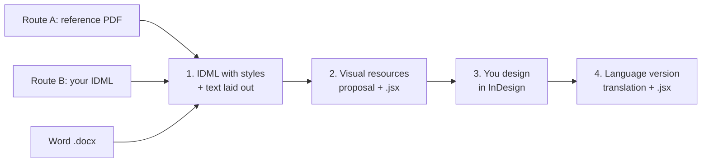

# Claude + InDesign: layout prep skill

**Claude doesn't lay out the document. It prepares it so you can lay it out in InDesign.**

> **Status: in development (v0.2.0).** This is the skill I use for my own documents. I'm improving it bit by bit, so expect changes. Feedback and issues are welcome.

A Claude skill (and Claude Code plugin) for editorial designers. It takes your
own design reference and a Word document. Before you start designing, you get:

- the **style system** taken from your reference (paragraph and character styles, colours, grid),
- **one InDesign file (.idml)** with every style in its group, every brand colour in the swatches panel, a table style, and **the Word text already laid out**: titles, lead, body, lists, bold and italics, tables, on threaded pages,
- an empty **template** with the same styles, to save as `.indt` for the next document,
- a **proposal of visual resources** (key figures, diagrams, mind maps, the boxes and cards of your reference) section by section, plus scripts that build them in InDesign as editable elements,
- once the design is finished, **a version in another language**: a reviewed translation and a script that saves a copy of your .indd and replaces the text in it, keeping the layout and the styles.

You lose most of the mechanical work. The pacing, emphasis, images and white space stay yours.

---

## Why this workflow

AI makes us faster, but faster doesn't always mean better. Choose the tool
for each document by its use, its goal and how it gets made.

- **For professional results** (print-ready or device-ready), Adobe's tools
  still give the best results, and InDesign is still the tool for professional layout.
  Adobe keeps adding AI to it, but many elements and details still have to be done by hand.
- **Laying out directly with Claude** isn't the answer either. The document
  needs retouching, so you keep iterating on one element and regenerating the
  whole file to fix a small detail. That wastes tokens.
- **So the two are combined.** Claude extracts the design, style and identity
  from a finished document and writes scripts that import the text straight
  into InDesign, with styles, columns and structure in place. All that's left is
  adding diagrams, images and visual elements.

### What I tried first

- **Adobe's official Claude connector** works in Adobe's cloud, at the level of
  Adobe Express. It doesn't open your .indd, doesn't touch desktop InDesign and
  has no workflow for editorial layout. It's useful for batch retouching, PDFs or
  social media pieces.
  ([MindStudio](https://www.mindstudio.ai/blog/claude-mcp-adobe-vs-photoshop-premiere-what-it-does),
  [Pasquale Pillitteri](https://pasqualepillitteri.it/en/news/1558/claude-adobe-creative-cloud-50-tools-single-prompt-2026))
- **MCP servers for InDesign** from independent developers, such as
  [Sidekick](https://sidekick.eastpole.nl/mcp/) and
  [claude-indesign](https://github.com/gummiz/claude-indesign), let Claude run
  scripts inside InDesign. They need Claude Desktop or Claude Code, Node, edited
  config files and system permissions, and several only work on macOS. They're
  another option, but they're still hard to set up.
- **Adobe MAX (November 2026)**: Adobe
  [announced it will open its desktop apps to external agents through MCP](https://techcrunch.com/2026/11/10/adobe-adds-more-ai-to-its-products-and-launches-an-mcp/),
  working on native files locally. The private beta starts in early 2027 and
  [only covers Photoshop, Illustrator, Premiere and After Effects](https://www.creativeboom.com/news/adobe-max-2026-all-the-big-announcements/).
  InDesign isn't on the list.
- **InDesign's own AI**: the
  [AI Assistant](https://community.adobe.com/announcements-670/ai-assistant-is-now-live-in-indesign-21-4-beta-1557550)
  (beta) creates styles if you dictate them one by one, and applies bulk changes.
  It isn't built to analyse a reference PDF and extract an identity.
  [Auto Style](https://creativepro.com/format-text-automatically-with-style-packs-in-indesign/)
  needs the styles to exist already. Opening a PDF as an editable document has
  problems too: text arrives fragmented and styles get renamed.

This workflow works when you're duplicating an existing InDesign document and
when you're starting a clean one from scratch.

### Two routes

- **A. You have a reference to replicate**: a PDF (from InDesign, Figma, Canva...)
  and the Word file. Claude measures the reference, builds the style system
  and gives you an IDML with the styles **and the text laid out** in them.
- **B. Your styles already live in InDesign**: export your template or a
  previous document as IDML (File > Save As > InDesign Markup) and share it with
  the Word file. Claude lays the text out **inside your own file**, with your
  styles, swatches and master pages. Add a PDF of a finished piece if you want
  Claude to follow it when choosing which style goes where.

The skill ships no default styles. Every style system comes from your own
reference or your own IDML.

---

## The workflow



Claude does the mechanical part of each step. The final design is yours.

| Step | You give | You get |
| --- | --- | --- |
| 1. Styles + laid-out text | Reference PDF (A) or your IDML (B), and the Word file | Style table (estimated values flagged), the `.idml` with the text laid out, and an empty template |
| 2. Visual resources | (from step 1) | Section-by-section proposal + one `.jsx` per resource |
| 3. Design | Your judgement | Your layout |
| 4. Language version | The PDF of the finished document, your `.indd`, and the target language | Page-by-page translation to review, a `.jsx` that translates a copy of your `.indd`, a report, and a list of manual fixes from the translated PDF |

What step 1 places: titles and subtitles, lead, headings, body, real and typed
lists, bold/italic/superscript as character styles, quotes, and Word tables as
InDesign tables with a table style from your identity. What it leaves for step
2 and for you: boxes, cards, bands, mind maps, images, covers and captions.

The number of pages is an estimate (plus one spare page): InDesign composes
the final text. If something doesn't fit it stays as overset text, never lost.

**Need it in another language?** Step 4 reads the PDF of the finished
document, translates it page by page keeping bold and coloured runs, and
waits for your review. The translation is checked against the PDF before the
script is built. You run the script on your `.indd`: it saves a copy, replaces
every paragraph in the copy (including lines cut with Enter and repeated
texts), sets the language for hyphenation and spelling, and writes a report
with lost column starts, overset text and anything to replace by hand. Tested
in InDesign 2026 on a 12-page document.

**New text for a document you already started?** The skill also writes an
ExtendScript (`import_docx.jsx`) that imports a Word file into the open
InDesign document with your styles, keeping bold and italics and adding pages.

### Example prompts

**Step 1, route A**
> Analyse this PDF as the design and identity base, and the Word document as
> the content. Extract titles, colours and fonts into a table, then generate an
> IDML with every paragraph, character and table style based on that identity,
> and the Word document laid out following the same visual style.

**Step 1, route B**
> Here's my InDesign template as IDML and the Word file. Lay the text out in
> my template using my styles.

**Step 2**
> With the context and content you've analysed, and with this identity,
> propose graphic resources section by section. For each one: what content it
> represents, why it helps the reader, and a sketch with the brand colours and
> fonts. Don't lay out the full document: only the resources, in content order.

**Step 4**
> This is the PDF of my finished document in Spanish, and I have the .indd.
> Translate it into English (US) and give me a script that replaces the Spanish text with the English
> text in a copy of my InDesign document, keeping the layout and the styles.

**Alternative: script import**
> Write an InDesign script in ExtendScript (ES3) that asks me for a .docx and
> places it in my open document with my styles.

The skill already knows the pitfalls: it never hand-writes IDML (it uses
tested generators and checks every file before handing it over), it writes
ES3 for InDesign scripts, and it turns bold and italics into character styles
so they survive.

---

## Install

The skill is distributed as a plugin through this repo's marketplace,
`merysugy/skillhub-indesign`. Add the marketplace once and you get updates as
the skill improves.

### Claude (web and desktop apps)

1. In **Settings**, open **Plugins** and choose **Add marketplace**.
2. Enter `merysugy/skillhub-indesign` and install the **indesign-layout-prep** plugin.
3. In a chat, type `/indesign-layout-prep`, or simply mention InDesign or IDML
   and the skill usually starts on its own.
4. Attach your reference PDF (or your IDML) and the Word file, and ask for step 1.

### Claude Code

```bash
/plugin marketplace add merysugy/skillhub-indesign
```

```bash
/plugin install indesign-layout-prep@skillhub-indesign
```

Then attach your files and ask for step 1. In Claude Code the command shows
up as `/indesign-layout-prep:indesign-layout-prep`.

### Other ways (no marketplace)

- **Upload the skill as a zip**: download `indesign-layout-prep.zip` from the
  [latest release](https://github.com/merysugy/skillhub-indesign/releases) (or
  build it with `./tools/package_skill.sh`) and upload it in **Settings >
  Capabilities > Skills**, with code execution on.
- **Copy the folder** for Claude Code:
  ```bash
  git clone https://github.com/merysugy/skillhub-indesign.git
  cp -r skillhub-indesign/skills/indesign-layout-prep ~/.claude/skills/
  ```

### Requirements

- **Adobe InDesign** (desktop, CS6 or later) to open the template and run the scripts.
- **Python 3**, standard library only, for the template generator and the
  Word inspector. Claude runs these itself when code execution is available.
- For step 4 checks: `pdfplumber` (Python) and, optionally, Node.js for the
  simulated test of the translation script.

### Running an InDesign script

**Window > Utilities > Scripts** → right-click **User** → **Reveal in Finder**
(or **Explorer**) → copy the `.jsx` there → double-click it in the Scripts panel.
Each script can be undone in one step with **Edit > Undo**.

---

## What's in the repo

```
skills/indesign-layout-prep/
├── SKILL.md                      # The workflow Claude follows
├── references/                   # One guide per step + ExtendScript rules
├── scripts/
│   ├── build_idml.py             # Route A: style system (+ Word) → .idml
│   ├── extract_idml.py           # Route B: your .idml → style-system JSON
│   ├── fill_idml.py              # Route B: Word laid out inside your .idml
│   ├── idml_content.py           # Shared: Word → styled story, tables, pages
│   ├── check_idml.py             # Structural check of any .idml
│   ├── build_translation_jsx.py  # Step 4: translations JSON → translation script
│   ├── check_translation_pdf.py  # Step 4: check the translation against the PDFs
│   ├── test_translate_mock.js    # Step 4: run the script on a simulated document
│   ├── inspect_docx.py           # Word structure report + style map for the import script
│   └── check_es3.py              # Catches modern JavaScript before InDesign does
└── assets/
    ├── style-system.schema.json  # Format of the style system
    ├── import_docx.jsx           # Alternative: import script for InDesign
    ├── visual_resource.jsx       # Step 2 resource script template + drawing helpers
    └── translate_document.jsx    # Step 4: saves a copy of the .indd and translates it
.claude-plugin/                   # Claude Code plugin + marketplace manifests
tools/package_skill.sh            # Builds the zip (alternative to the marketplace)
```

You can also use the tools without Claude:

```bash
python3 skills/indesign-layout-prep/scripts/extract_idml.py my-template.idml -o my-styles.json
python3 skills/indesign-layout-prep/scripts/build_idml.py my-styles.json -o my-template.idml --specimen
python3 skills/indesign-layout-prep/scripts/build_idml.py my-styles.json -o my-document.idml --content content.docx
python3 skills/indesign-layout-prep/scripts/fill_idml.py my-template.idml my-styles.json content.docx -o my-document.idml
python3 skills/indesign-layout-prep/scripts/check_idml.py my-document.idml
python3 skills/indesign-layout-prep/scripts/inspect_docx.py content.docx --style-system my-styles.json
python3 skills/indesign-layout-prep/scripts/check_es3.py my-script.jsx
```

---

## Claude as an assistant, not a replacement

The point isn't to replace the designer or to take shortcuts with prompts.
Everyone has the same AI tools now. What makes the difference is knowing when
to use them, how, and what for.

It takes judgement to know when Claude can handle a whole document because it
doesn't need much work or add much value, and when a whitepaper or a magazine
needs professional tools. In the second case, AI doesn't replace InDesign. It
takes over the tedious, manual work.

The goal is to get the most out of your skills, cut working time and deliver
quality, so more time goes to design, document planning and visual elements.
Those are what add real value to the result.

## Contributing

Issues and pull requests are welcome, especially reports from real InDesign
versions (what opened cleanly and what didn't), and new resource templates
for step 2.

## License

[MIT](LICENSE) © Maria Sugasaga
