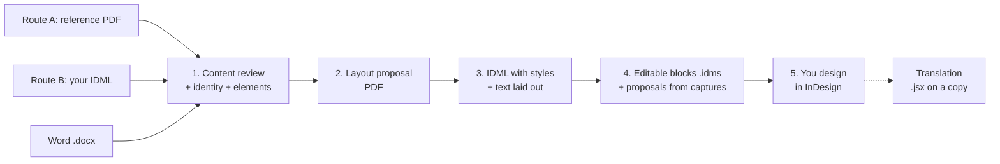

# Claude + InDesign: layout prep skill

**Claude doesn't lay out the document. It prepares it so you can lay it out in InDesign.**

[](https://skills.sh/merysugy/skillhub-indesign)

> **Status: in development (v0.3.0).** This is the skill I use for my own documents. I'm improving it bit by bit, so expect changes. Feedback and issues are welcome.

A Claude skill (and Claude Code plugin) for editorial designers, in any
language. It takes your own design reference and a Word document. Before you
start designing, you get:

- a **review of the content**: repeated versions of the same text, claims and figures without a source, text copied from another document, real data in screenshots,
- the **style system** taken from your reference (paragraph and character styles, colours, grid),
- a **proposal of graphic elements** section by section, and a **full layout proposal** as a PDF in your reference's style, so decisions are made on something visual,
- **one InDesign file (.idml)** with every style in its group, every brand colour in the swatches panel, a table style, and **the Word text already laid out**: titles, lead, body, lists, bold and italics, tables, on threaded pages,
- an empty **template** with the same styles, to save as `.indt` for the next document,
- **editable blocks (.idms)**: send a capture of a diagram, box, card or key figure and you get a file to drag onto your page, as native InDesign objects with your styles and swatches,
- **proposals from captures**: where your product screenshots fit, or what to put in an empty area of a page,
- once the design is finished, **a version in another language**: a reviewed translation and a script that saves a copy of your .indd and replaces the text in it, keeping the layout and the styles.

You lose most of the mechanical work. The pacing, emphasis, images and white space stay yours.

---

## Why this workflow

AI makes us faster, but faster doesn't always mean better. Choose the tool
for each document by its use, its goal and how it gets made.

- **For professional results** (print-ready or device-ready), Adobe's tools
  still give the best results, and InDesign is still the tool for professional layout.
  Adobe keeps adding AI to it, but many elements and details still have to be done by hand.
- **Laying out directly with Claude** isn't the answer either. The document
  needs retouching, so you keep iterating on one element and regenerating the
  whole file to fix a small detail. That wastes tokens.
- **So the two are combined.** Claude extracts the design, style and identity
  from a reference, builds an InDesign file with the text already laid out in
  those styles, and turns diagrams, boxes and cards into editable blocks you
  drag onto the page. All that's left is the design itself: rhythm, emphasis,
  images and white space.

### What I tried first

- **Adobe's official Claude connector** works in Adobe's cloud, at the level of
  Adobe Express. It doesn't open your .indd, doesn't touch desktop InDesign and
  has no workflow for editorial layout. It's useful for batch retouching, PDFs or
  social media pieces.
  ([MindStudio](https://www.mindstudio.ai/blog/claude-mcp-adobe-vs-photoshop-premiere-what-it-does),
  [Pasquale Pillitteri](https://pasqualepillitteri.it/en/news/1558/claude-adobe-creative-cloud-50-tools-single-prompt-2026))
- **MCP servers for InDesign** from independent developers, such as
  [Sidekick](https://sidekick.eastpole.nl/mcp/) and
  [claude-indesign](https://github.com/gummiz/claude-indesign), let Claude run
  scripts inside InDesign. They need Claude Desktop or Claude Code, Node, edited
  config files and system permissions, and several only work on macOS. They're
  another option, but they're still hard to set up.
- **Adobe MAX (November 2026)**: Adobe
  [announced it will open its desktop apps to external agents through MCP](https://techcrunch.com/2026/11/10/adobe-adds-more-ai-to-its-products-and-launches-an-mcp/),
  working on native files locally. The private beta starts in early 2027 and
  [only covers Photoshop, Illustrator, Premiere and After Effects](https://www.creativeboom.com/news/adobe-max-2026-all-the-big-announcements/).
  InDesign isn't on the list.
- **InDesign's own AI**: the
  [AI Assistant](https://community.adobe.com/announcements-670/ai-assistant-is-now-live-in-indesign-21-4-beta-1557550)
  (beta) creates styles if you dictate them one by one, and applies bulk changes.
  It isn't built to analyse a reference PDF and extract an identity.
  [Auto Style](https://creativepro.com/format-text-automatically-with-style-packs-in-indesign/)
  needs the styles to exist already. Opening a PDF as an editable document has
  problems too: text arrives fragmented and styles get renamed.

This workflow works when you're duplicating an existing InDesign document and
when you're starting a clean one from scratch.

### Two routes

- **A. You have a reference to replicate**: a PDF (from InDesign, Figma, Canva...)
  and the Word file. Claude measures the reference, builds the style system
  and gives you an IDML with the styles **and the text laid out** in them.
- **B. Your styles already live in InDesign**: export your template or a
  previous document as IDML (File > Save As > InDesign Markup) and share it with
  the Word file. Claude lays the text out **inside your own file**, with your
  styles, swatches and master pages. Add a PDF of a finished piece if you want
  Claude to follow it when choosing which style goes where.

The skill ships no default styles. Every style system comes from your own
reference or your own IDML.

---

## The workflow



Claude does the mechanical part of each phase, shows every proposal before
building anything, and waits for your go-ahead between phases. The final
design is yours.

| Phase | You give | You get |
| --- | --- | --- |
| 1. Review and analyse | Reference PDF (A) or your IDML (B), and the Word file | Content review with options to decide, style table (estimated values flagged), graphic-elements proposal section by section, including the sales space (closing page, call to action, contacts) |
| 2. Layout proposal | Your feedback on phase 1 | The whole document as a PDF in the reference style, with the text Claude wrote marked, and a list of what changed and what's pending |
| 3. IDML | Your go-ahead | The `.idml` with the text laid out, an empty template, and a check of both files |
| 4. Blocks and captures | A capture of an element, of your product screens, or of an empty page area | An `.idms` block to drag in (with a preview compared to your capture), or a proposal shown in context |
| 5. Design | Your judgement | Your layout |
| Translation | The PDF of the finished document, your `.indd`, and the target language | Page-by-page translation to review, a `.jsx` that translates a copy of your `.indd`, a report, and a list of manual fixes from the translated PDF |

Most of the iteration happens in phase 4, with short requests and a
screenshot: "make it editable", "where would these screenshots go", "what
could go here". If the capture shows something Claude proposed earlier, it
recognises it and builds from that model. An `.idms` from another
conversation can be converted back to a model and changed, instead of being
redrawn.

Graphic elements come as `.idms` blocks, not as scripts. A block is placed
directly, like any file, arrives as native objects with the document's styles
and swatches, and has a preview checked against your capture before it's
delivered. Scripts for diagrams gave problems in practice, so they are only
an alternative for elements that have to be computed inside the open
document.

What phase 3 places: titles and subtitles, lead, headings, body, real and typed
lists, bold/italic/superscript as character styles, quotes, and Word tables as
InDesign tables with a table style from your identity. Boxes, cards, bands and
diagrams come as `.idms` blocks in phase 4. Images, covers and master page
items (header, footer, page number) stay with you.

The number of pages is an estimate (plus one spare page): InDesign composes
the final text. If something doesn't fit it stays as overset text, never lost.

**Need it in another language?** The translation reads the PDF of the finished
document, translates it page by page keeping bold and coloured runs, and
waits for your review. The translation is checked against the PDF before the
script is built. You run the script on your `.indd`: it saves a copy, replaces
every paragraph in the copy (including lines cut with Enter and repeated
texts), sets the language for hyphenation and spelling, and writes a report
with lost column starts, overset text and anything to replace by hand. Tested
in InDesign 2026 on a 12-page document.

**New text for a document you already started?** The skill also writes an
ExtendScript (`import_docx.jsx`) that imports a Word file into the open
InDesign document with your styles, keeping bold and italics and adding pages.

### Example prompts

**Phase 1**
> Analyse this PDF as the design and identity base, and the Word document as
> the content. Review the content, extract titles, colours and fonts into a
> table, and propose graphic elements section by section.

**Phase 2**
> Make a full layout proposal in that style.

**Phase 3, route A**
> Send it to InDesign: an IDML with every paragraph, character and table style
> based on that identity, and the Word document laid out.

**Phase 3, route B**
> Here's my InDesign template as IDML and the Word file. Lay the text out in
> my template using my styles.

**Phase 4**
> (with a capture of a diagram) Make this editable so I can place it in InDesign.

> (with screenshots of the app) Where would these go in the document?

> (with a capture of an empty area) What could go here? Prepare the editable file too.

**Translation**
> This is the PDF of my finished document in Spanish, and I have the .indd.
> Translate it into English (US) and give me a script that replaces the Spanish text with the English
> text in a copy of my InDesign document, keeping the layout and the styles.

**Alternative: script import**
> Write an InDesign script in ExtendScript (ES3) that asks me for a .docx and
> places it in my open document with my styles.

The skill already knows the pitfalls: it never hand-writes IDML or IDMS (it
uses tested generators and checks every file before handing it over), it
never reuses styles, colours or content from another project, it never
invents figures, it writes ES3 for InDesign scripts, and it turns bold and
italics into character styles so they survive. It also says what it checked
and what it couldn't: Claude can't open InDesign.

---

## Install

The skill is distributed as a plugin through this repo's marketplace,
`merysugy/skillhub-indesign`. Add the marketplace once and you get updates as
the skill improves.

### Claude (web and desktop apps)

1. In **Settings**, open **Plugins** and choose **Add marketplace**.
2. Enter `merysugy/skillhub-indesign` and install the **indesign-layout-prep** plugin.
3. In a chat, type `/indesign-layout-prep`, or simply mention InDesign or IDML
   and the skill usually starts on its own.
4. Attach your reference PDF (or your IDML) and the Word file, and ask for phase 1.

### Claude Code

```bash
/plugin marketplace add merysugy/skillhub-indesign
```

```bash
/plugin install indesign-layout-prep@skillhub-indesign
```

Then attach your files and ask for phase 1. In Claude Code the command shows
up as `/indesign-layout-prep:indesign-layout-prep`.

### With the skills CLI ([skills.sh](https://skills.sh/merysugy/skillhub-indesign))

Works with Claude Code and the other agents the
[skills CLI](https://github.com/vercel-labs/skills) supports. It installs the
skill in the current project; add `-g` to install it for all your projects.

```bash
npx skills add merysugy/skillhub-indesign --skill indesign-layout-prep
```

To get the latest version later:

```bash
npx skills update
```

### Other ways (no marketplace)

- **Upload the skill as a zip**: download `indesign-layout-prep.zip` from the
  [latest release](https://github.com/merysugy/skillhub-indesign/releases) (or
  build it with `./tools/package_skill.sh`) and upload it in **Settings >
  Capabilities > Skills**, with code execution on.
- **Copy the folder** for Claude Code:
  ```bash
  git clone https://github.com/merysugy/skillhub-indesign.git
  cp -r skillhub-indesign/skills/indesign-layout-prep ~/.claude/skills/
  ```

### Requirements

- **Adobe InDesign** (desktop, CS6 or later) to open the files and run the scripts.
- **Python 3**, standard library only, for the IDML and IDMS generators and
  the checks. Claude runs these itself when code execution is available.
- For block previews: `Pillow` and `fontTools` (Python).
- For translation checks: `pdfplumber` (Python) and, optionally, Node.js for
  the simulated test of the translation script.

### Placing an .idms block

Drag the `.idms` onto the page, or use **File > Place**. If it has images,
keep the `Links` folder next to it and relink them with **Window > Links >
Relink** if they show as missing.

### Running an InDesign script

**Window > Utilities > Scripts** → right-click **User** → **Reveal in Finder**
(or **Explorer**) → copy the `.jsx` there → double-click it in the Scripts panel.
Each script can be undone in one step with **Edit > Undo**.

---

## What's in the repo

```
skills/indesign-layout-prep/
├── SKILL.md                      # The workflow Claude follows
├── references/                   # One guide per phase + ExtendScript rules
├── scripts/
│   ├── build_idml.py             # Route A: style system (+ Word) → .idml
│   ├── extract_idml.py           # Route B: your .idml → style-system JSON
│   ├── fill_idml.py              # Route B: Word laid out inside your .idml
│   ├── idml_content.py           # Shared: Word → styled story, tables, pages
│   ├── build_snippet.py          # Phase 4: block model → .idms
│   ├── preview_model.py          # Phase 4: PNG preview of a block, alone or on a page
│   ├── idms_to_model.py          # Phase 4: an earlier .idms back to a model
│   ├── snippet_model.py          # Shared: loads and checks a block model
│   ├── check_idml.py             # Structural check of any .idml or .idms
│   ├── build_translation_jsx.py  # Translation: JSON → translation script
│   ├── check_translation_pdf.py  # Translation: check against the PDFs
│   ├── test_translate_mock.js    # Translation: run the script on a simulated document
│   ├── inspect_docx.py           # Word structure report + style map for the import script
│   └── check_es3.py              # Catches modern JavaScript before InDesign does
└── assets/
    ├── style-system.schema.json  # Format of the style system
    ├── snippet-model.example.json # Block model example (neutral styles)
    ├── import_docx.jsx           # Alternative: import script for InDesign
    ├── visual_resource.jsx       # Alternative only: an element computed inside the open document
    └── translate_document.jsx    # Translation: saves a copy of the .indd and translates it
.claude-plugin/                   # Claude Code plugin + marketplace manifests
tools/package_skill.sh            # Builds the zip (alternative to the marketplace)
```

You can also use the tools without Claude:

```bash
python3 skills/indesign-layout-prep/scripts/extract_idml.py my-template.idml -o my-styles.json
python3 skills/indesign-layout-prep/scripts/build_idml.py my-styles.json -o my-template.idml --specimen
python3 skills/indesign-layout-prep/scripts/build_idml.py my-styles.json -o my-document.idml --content content.docx
python3 skills/indesign-layout-prep/scripts/fill_idml.py my-template.idml my-styles.json content.docx -o my-document.idml
python3 skills/indesign-layout-prep/scripts/check_idml.py my-document.idml
python3 skills/indesign-layout-prep/scripts/build_snippet.py my-block.json -o my-block.idms --zip
python3 skills/indesign-layout-prep/scripts/preview_model.py my-block.json -o my-block.png --fonts ~/Library/Fonts
python3 skills/indesign-layout-prep/scripts/idms_to_model.py my-block.idms -o my-block.json
python3 skills/indesign-layout-prep/scripts/inspect_docx.py content.docx --style-system my-styles.json
python3 skills/indesign-layout-prep/scripts/check_es3.py my-script.jsx
```

---

## Claude as an assistant, not a replacement

The point isn't to replace the designer or to take shortcuts with prompts.
Everyone has the same AI tools now. What makes the difference is knowing when
to use them, how, and what for.

It takes judgement to know when Claude can handle a whole document because it
doesn't need much work or add much value, and when a whitepaper or a magazine
needs professional tools. In the second case, AI doesn't replace InDesign. It
takes over the tedious, manual work.

The goal is to get the most out of your skills, cut working time and deliver
quality, so more time goes to design, document planning and visual elements.
Those are what add real value to the result.

## Contributing

Issues and pull requests are welcome, especially reports from real InDesign
versions (what opened cleanly and what didn't), and `.idms` elements the
block builder doesn't support yet (gradients, object styles, tables).

## License

[MIT](LICENSE) © Maria Sugasaga
