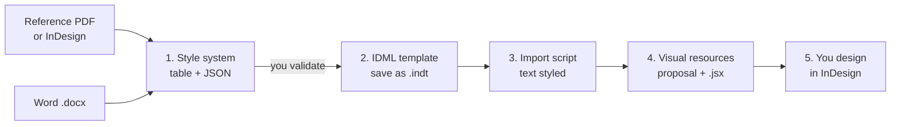

# Claude + InDesign: layout prep skill

**Claude doesn't lay out the document. It prepares it so you can lay it out in InDesign.**

A Claude skill (and Claude Code plugin) for editorial designers. It takes a
reference design and a Word document. Before you start designing, you get:

- the **style system** taken from the reference (paragraph and character styles, colours, grid),
- an **InDesign template (.idml)** with every style in its group and every brand colour in the swatches panel,
- an **ExtendScript** that imports the Word text with your styles applied, keeps bold and italics, and adds the pages and threaded frames it needs,
- a **proposal of visual resources** (key figures, diagrams, mind maps) section by section, plus scripts that build them in InDesign as editable elements.

You lose most of the mechanical work. The pacing, emphasis, images and white space stay yours.

---

## Why this workflow

AI makes us faster, but faster doesn't always mean better. Choose the tool
for each document by its use, its goal and how it gets made.

- **For professional results** (print-ready or device-ready), Adobe's tools
  still give the best results, and InDesign is still the tool for professional layout.
  Adobe keeps adding AI to it, but many elements and details still have to be done by hand.
- **Laying out directly with Claude** isn't the answer either. The document
  needs retouching, so you keep iterating on one element and regenerating the
  whole file to fix a small detail. That wastes tokens.
- **So the two are combined.** Claude extracts the design, style and identity
  from a finished document and writes scripts that import the text straight
  into InDesign, with styles, columns and structure in place. All that's left is
  adding diagrams, images and visual elements.

### What I tried first

- **Adobe's official Claude connector** works in Adobe's cloud, at the level of
  Adobe Express. It doesn't open your .indd, doesn't touch desktop InDesign and
  has no workflow for editorial layout. It's useful for batch retouching, PDFs or
  social media pieces.
  ([MindStudio](https://www.mindstudio.ai/blog/claude-mcp-adobe-vs-photoshop-premiere-what-it-does),
  [Pasquale Pillitteri](https://pasqualepillitteri.it/en/news/1558/claude-adobe-creative-cloud-50-tools-single-prompt-2026))
- **MCP servers for InDesign** from independent developers, such as
  [Sidekick](https://sidekick.eastpole.nl/mcp/) and
  [claude-indesign](https://github.com/gummiz/claude-indesign), let Claude run
  scripts inside InDesign. They need Claude Desktop or Claude Code, Node, edited
  config files and system permissions, and several only work on macOS. They're
  another option, but they're still hard to set up.
- **Adobe MAX (November 2026)**: Adobe
  [announced it will open its desktop apps to external agents through MCP](https://techcrunch.com/2026/11/10/adobe-adds-more-ai-to-its-products-and-launches-an-mcp/),
  working on native files locally. The private beta starts in early 2027 and
  [only covers Photoshop, Illustrator, Premiere and After Effects](https://www.creativeboom.com/news/adobe-max-2026-all-the-big-announcements/).
  InDesign isn't on the list.
- **InDesign's own AI**: the
  [AI Assistant](https://community.adobe.com/announcements-670/ai-assistant-is-now-live-in-indesign-21-4-beta-1557550)
  (beta) creates styles if you dictate them one by one, and applies bulk changes.
  It isn't built to analyse a reference PDF and extract an identity.
  [Auto Style](https://creativepro.com/format-text-automatically-with-style-packs-in-indesign/)
  needs the styles to exist already. Opening a PDF as an editable document has
  problems too: text arrives fragmented and styles get renamed.

This workflow works when you're duplicating an existing InDesign document and
when you're starting a clean one from scratch.

---

## The workflow



Claude does the mechanical part of each step. The final design is yours.

| Step | You give | You get |
| --- | --- | --- |
| 1. Identity and styles | Reference PDF + Word | Style table (estimated values flagged) + `style-system.json` |
| 2. IDML template | Validated table, format (e.g. A4, 20 mm, 2 columns) | `template.idml` + `specimen.idml` → save as `.indt` |
| 3. Text import | Word document | Import mapping (well-styled Word) or `import_docx.jsx` (hand-made Word) |
| 4. Visual resources | (from steps 1-3) | Section-by-section proposal + one `.jsx` per resource |
| 5. Design | Your judgement | Your layout |

Once you've saved a template, skip steps 1 and 2 for later documents.

### Example prompts

**Step 1**
> Analyse this PDF as the design and identity base, and the Word document as
> the content to lay out. Give me the style system in a table, with every
> element classified: paragraph and character styles with font and weight,
> size, leading, space before and after, colour and based-on style. Organise
> the styles in a hierarchy and include repeated resources (callouts, quotes,
> captions, tables). Mark anything you can't measure reliably as estimated.

**Step 2**
> With this style system, generate an InDesign IDML file in A4, with 20 mm
> margins and two columns. Include every paragraph and character style grouped
> in folders, and every colour in the swatches panel with the brand names.
> Don't add content: only the template.

**Step 3**
> Write an InDesign script in ExtendScript (ES3). It should ask me for a .docx,
> place it on the first page, add the pages and threaded frames it needs and
> apply my styles using this table: "Heading 1" → Headline, "Heading 2" →
> Subhead, "Normal" → Body. Also detect hand-made headings (short bold
> paragraphs). Keep the italics and bold in the text.

**Step 4**
> With the context and content you've analysed, and with this identity,
> propose graphic resources section by section. For each one: what content it
> represents, why it helps the reader, and a sketch with the brand colours and
> fonts. Don't lay out the full document: only the resources, in content order.

The skill already knows the pitfalls these prompts guard against. It writes
ES3 (InDesign fails on modern JavaScript), it turns bold and italics into
character styles before clearing overrides, and it waits for you to validate
the styles before it builds the template.

---

## Install

### Claude.ai (web and desktop apps)

1. Download `indesign-layout-prep.zip` from the
   [latest release](https://github.com/merysugy/skillhub-indesign/releases), or build it:
   `./tools/package_skill.sh` → `dist/indesign-layout-prep.zip`.
2. Go to **Settings > Capabilities**, make sure **Code execution** is on, and
   upload the zip under **Skills**.
3. Start a chat, attach your reference PDF and Word file, and ask for step 1.

### Claude Code (plugin)

```bash
/plugin marketplace add merysugy/skillhub-indesign
/plugin install indesign-layout-prep@skillhub-indesign
```

### Claude Code (manual)

```bash
git clone https://github.com/merysugy/skillhub-indesign.git
cp -r skillhub-indesign/skills/indesign-layout-prep ~/.claude/skills/
```

### Requirements

- **Adobe InDesign** (desktop, CS6 or later) to open the template and run the scripts.
- **Python 3**, standard library only, for the template generator and the
  Word inspector. Claude runs these itself when code execution is available.

### Running an InDesign script

**Window > Utilities > Scripts** → right-click **User** → **Reveal in Finder**
(or **Explorer**) → copy the `.jsx` there → double-click it in the Scripts panel.
Each script can be undone in one step with **Edit > Undo**.

---

## What's in the repo

```
skills/indesign-layout-prep/
├── SKILL.md                      # The workflow Claude follows
├── references/                   # One guide per step + ExtendScript rules
├── scripts/
│   ├── build_idml.py             # style-system JSON → .idml template
│   ├── inspect_docx.py           # Word structure report + style map for the import script
│   └── check_es3.py              # Catches modern JavaScript before InDesign does
└── assets/
    ├── style-system.schema.json  # Format of the style system
    ├── style-system.example.json # Full example (fictional brand)
    ├── import_docx.jsx           # Step 3 import script template
    └── visual_resource.jsx       # Step 4 resource script template + drawing helpers
examples/                         # Generated template, specimen and a sample Word file
.claude-plugin/                   # Claude Code plugin + marketplace manifests
tools/package_skill.sh            # Builds the zip for claude.ai
```

You can also use the tools without Claude:

```bash
python3 skills/indesign-layout-prep/scripts/build_idml.py my-styles.json -o my-template.idml --specimen
python3 skills/indesign-layout-prep/scripts/inspect_docx.py content.docx --style-system my-styles.json
python3 skills/indesign-layout-prep/scripts/check_es3.py my-script.jsx
```

Try it: open `examples/northwind-template.idml` in InDesign, run
`import_docx.jsx` and choose `examples/sample-content.docx`.

---

## Claude as an assistant, not a replacement

The point isn't to replace the designer or to take shortcuts with prompts.
Everyone has the same AI tools now. What makes the difference is knowing when
to use them, how, and what for.

It takes judgement to know when Claude can handle a whole document because it
doesn't need much work or add much value, and when a whitepaper or a magazine
needs professional tools. In the second case, AI doesn't replace InDesign. It
takes over the tedious, manual work.

The goal is to get the most out of your skills, cut working time and deliver
quality, so more time goes to design, document planning and visual elements.
Those are what add real value to the result.

## Contributing

Issues and pull requests are welcome, especially reports from real InDesign
versions (what opened cleanly and what didn't), and new resource templates
for step 4.

## License

[MIT](LICENSE) © Maria Sugasaga
